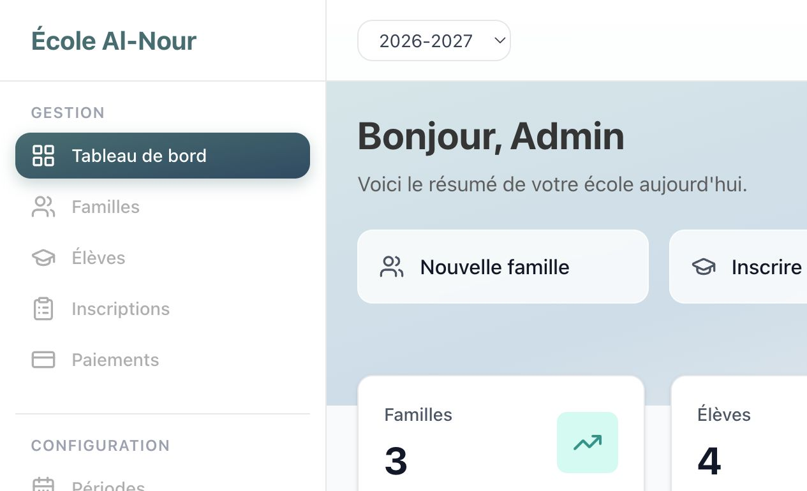
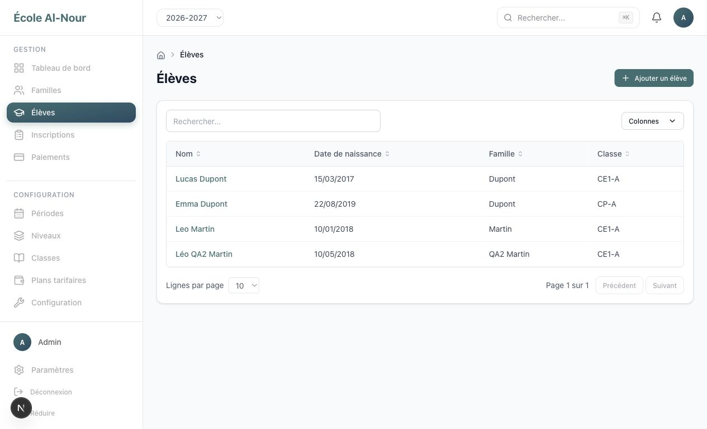
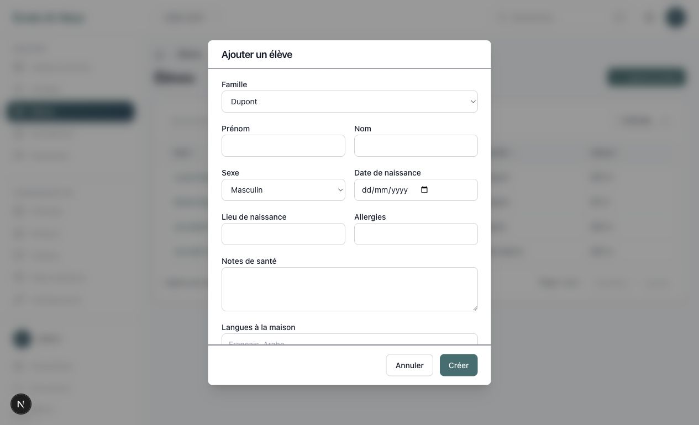
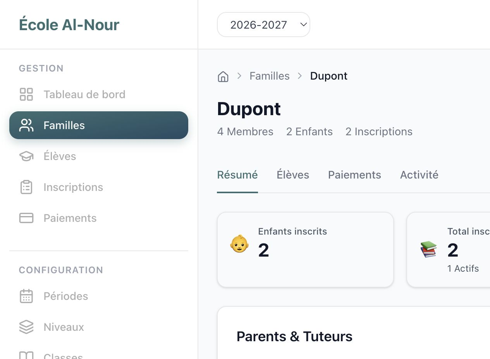
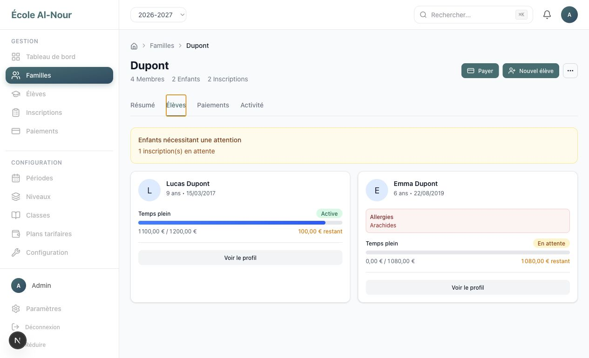
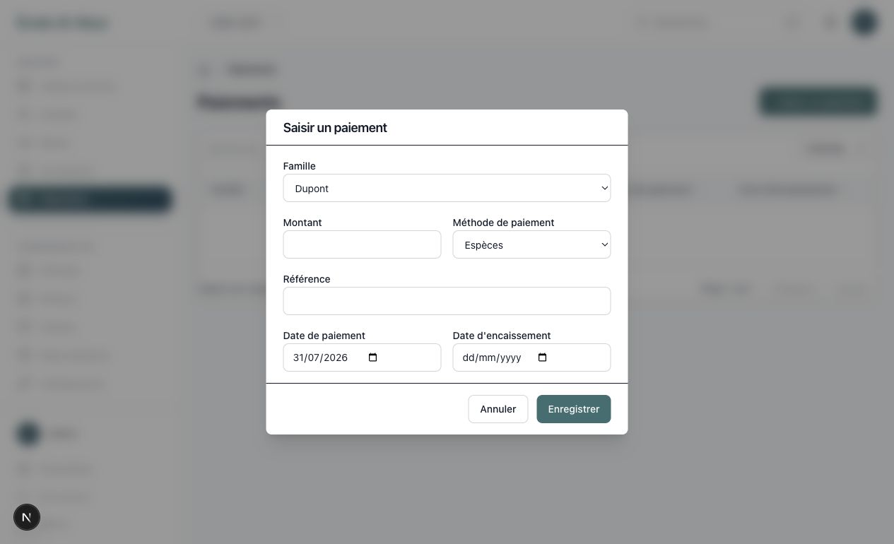
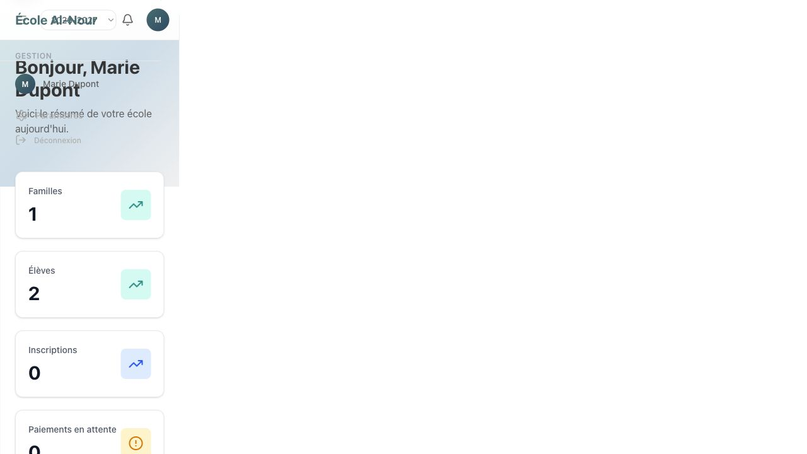
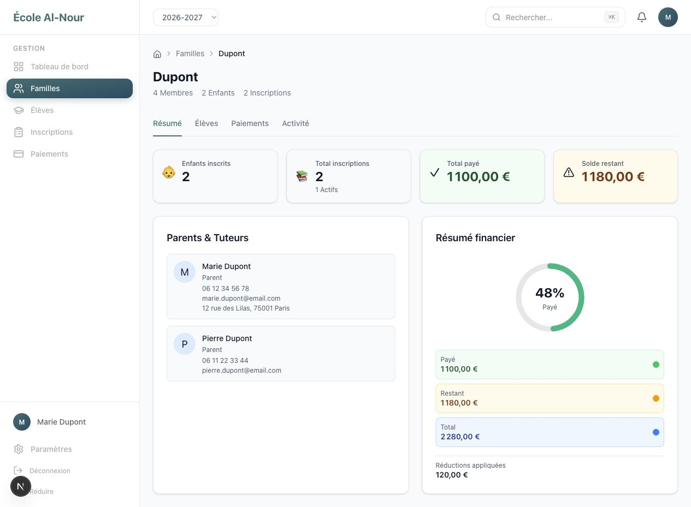
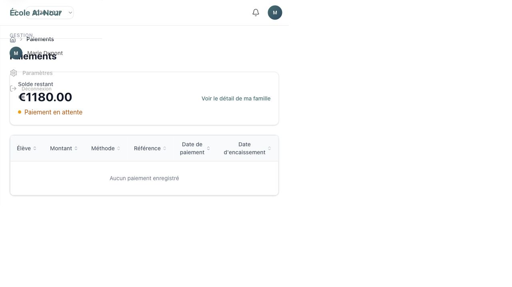

# Audit UX — parcours famille-centrique

Date: 31 juillet 2026

## Périmètre

Audit combiné UX et accessibilité visible des parcours administrateur et parent pour :

- créer une famille ;
- ajouter un parent ou tuteur ;
- ajouter un élève ;
- inscrire un élève ;
- enregistrer ou effectuer un paiement ;
- consulter la situation familiale.

## Verdict

La fiche famille est déjà le meilleur socle produit, mais l'application la contourne avec des
créations globales depuis le tableau de bord et les listes. Le portail parent réutilise la structure
du back-office, ne propose aucun paiement en ligne et présente des ruptures de mise en page sur le
tableau de bord et la page Paiements.

## Parcours observé

### Étape 1 — Tableau de bord administrateur

Santé : à simplifier.

Le tableau de bord propose quatre raccourcis concurrents : créer une famille, inscrire un élève,
saisir un paiement et ajouter un élève. Trois d'entre eux demandent ensuite de retrouver ou
sélectionner une famille, alors que la famille devrait être le point de départ.



### Étape 2 — Liste globale des élèves

Santé : structure de consultation saine, mutation mal placée.

La recherche, le tri et la consultation fonctionnent bien. Le bouton « Ajouter un élève » crée
cependant un second point d'entrée et impose un choix de famille dans un formulaire long.





### Étape 3 — Fiche famille administrateur

Santé : bonne fondation.

La fiche réunit déjà responsables, enfants, inscriptions, soldes et historique. L'onglet Élèves
montre les montants restants et l'état de chaque inscription, ce qui en fait naturellement l'espace
de travail central.





Points à corriger :

- « Payer » signifie en réalité « Enregistrer un règlement » manuel ;
- l'ajout de parent/tuteur n'est pas exposé malgré un composant existant ;
- les actions élève et inscription renvoient vers des fiches globales et perdent le contexte famille ;
- les actions principales doivent être regroupées et hiérarchisées.

### Étape 4 — Registre global des paiements

Santé : utile comme registre, mauvais point de création.

Le formulaire global demande une famille, un montant, une méthode et des dates comptables. C'est un
outil d'encaissement administrateur, pas un paiement parent. Il doit rester disponible depuis la
famille, avec la famille déjà fixée, et disparaître comme création globale.



### Étape 5 — Tableau de bord parent

Santé : critique.

Le parent voit la même architecture « Familles / Élèves / Inscriptions / Paiements » que
l'administrateur, alors que chaque liste est limitée à ses propres données. Le texte parle encore de
« votre école ». Dans la largeur testée, le contenu est comprimé dans une colonne étroite et se
superpose à la navigation.



### Étape 6 — Fiche famille parent

Santé : bonne information, action principale absente.

Le solde de 1 180 € est clairement visible, mais aucun bouton ne permet de le régler. La fiche
devrait devenir « Ma famille » et porter le CTA principal « Payer en ligne ».



### Étape 7 — Page Paiements parent

Santé : critique.

La page répète le solde et l'historique, puis renvoie vers la famille. Elle ne propose aucune action
de paiement et son rendu est également comprimé. Elle peut être supprimée de la navigation parent au
profit de l'onglet Finances de « Ma famille ».



## Architecture d'information cible

### Administration

```text
Familles
├── Créer une famille
└── Fiche famille
    ├── Résumé
    ├── Membres
    │   ├── Ajouter un parent/tuteur
    │   ├── Inviter au portail
    │   └── Ajouter un élève
    ├── Inscriptions
    │   ├── Inscrire un élève
    │   ├── Affecter une classe
    │   └── Gérer le statut ou la réduction
    └── Finances
        ├── Enregistrer un règlement
        ├── Consulter le solde
        └── Consulter l'historique
```

Les pages globales Élèves, Inscriptions et Paiements deviennent des vues de recherche, de suivi et
de reporting sans bouton de création.

### Parent

```text
Accueil
└── Ma famille
    ├── Mes enfants
    ├── Mes inscriptions
    ├── Solde et détail
    ├── Payer en ligne
    └── Historique

Profil
```

Le parent ne doit pas parcourir des listes globales contenant une seule famille et seulement ses
propres enfants. `/dashboard/families` doit ouvrir directement sa famille liée.

## Distinction nécessaire des paiements

| Administration | Parent |
|---|---|
| « Enregistrer un règlement » | « Payer en ligne » |
| Espèces, chèque, virement, carte TPE | Checkout hébergé par le prestataire |
| Montant et date contrôlés par l'opérateur | Famille dérivée de la session |
| Création comptable immédiate | Confirmation uniquement par webhook signé |
| Remboursement administratif | Aucun montant négatif saisi par le parent |

Le paiement parent ne doit pas réutiliser `recordPaymentAction`. L'option `STRIPE` actuelle est
seulement une valeur de formulaire ; il n'existe pas encore de Checkout ni de webhook.

## Risques structurels à corriger avant le paiement en ligne

1. La remise est déduite deux fois dans `recordPayment`.
2. Les écrans ne partagent pas le même périmètre de période, statut et solde.
3. Le modèle actuel représente une allocation par inscription, pas une transaction familiale.
4. Une invitation parent ne transporte pas la famille à laquelle rattacher le compte.
5. Certaines actions administrateur restent visibles aux parents avant d'être refusées côté serveur.
6. Le portail parent casse visuellement sur certaines routes à la largeur de navigateur testée.

## Recommandations priorisées

### Lot 1 — Simplification famille-centrique

- retirer les raccourcis Élève, Inscription et Paiement du tableau de bord ;
- retirer les boutons de création des listes globales ;
- conserver ces listes comme annuaires et registres ;
- brancher l'ajout de parent/tuteur dans la fiche famille ;
- garder « Ajouter un élève », « Inscrire » et « Enregistrer un règlement » dans la famille ;
- préserver le contexte famille dans les fils d'Ariane et retours ;
- renommer les actions de manière cohérente.

### Lot 2 — Portail parent

- remplacer la navigation back-office par « Accueil / Ma famille / Profil » ;
- rediriger directement le parent vers sa famille ;
- corriger les ruptures de mise en page du tableau de bord et des paiements ;
- masquer toutes les actions administrateur ;
- afficher un CTA « Payer en ligne » près du solde.

### Lot 3 — Paiement en ligne

- corriger d'abord la sémantique des montants et soldes ;
- lier invitation, personne et famille ;
- introduire une transaction familiale et ses allocations ;
- créer un checkout sécurisé et un webhook idempotent ;
- gérer explicitement succès, échec, expiration et remboursement.

## Accessibilité et limites

- Les captures confirment des problèmes de reflow sur deux pages parent.
- Les libellés « Payer » et « Saisir un paiement » ne décrivent pas la même action.
- Les changements de statut et les erreurs devront être testés au clavier et avec lecteur d'écran.
- Les captures seules ne permettent pas de conclure à une conformité WCAG complète.
- Aucun vrai paiement en ligne ne pouvait être audité puisqu'il n'existe pas encore.
