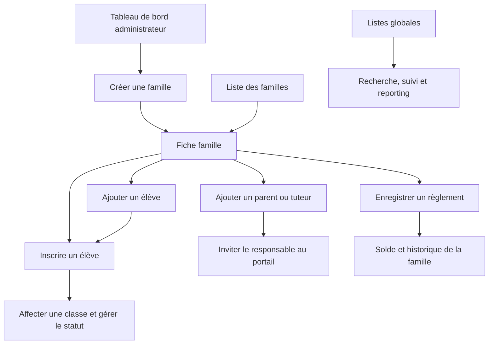
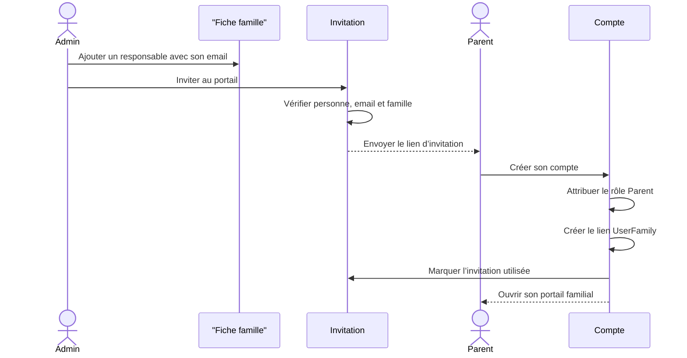
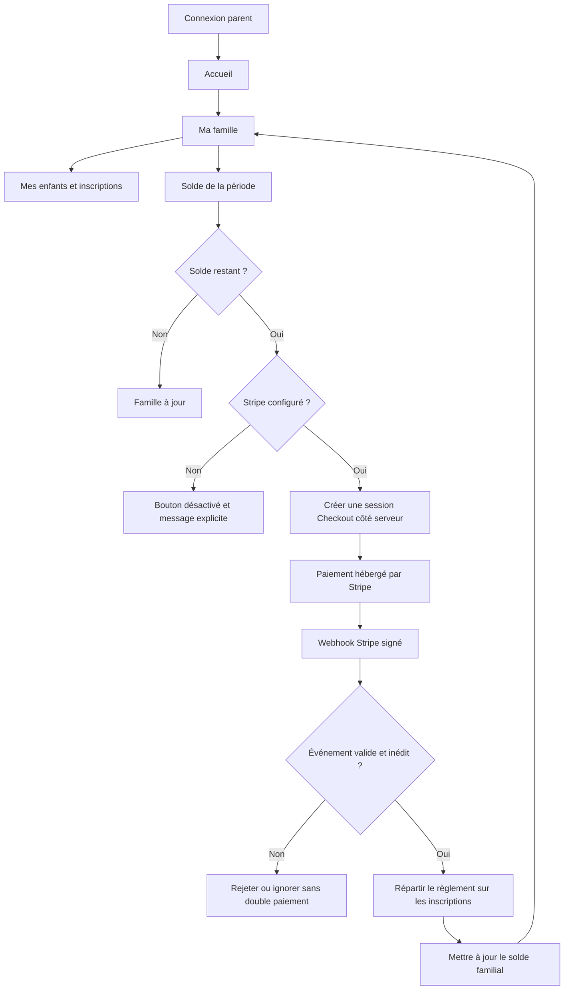

# Workflows améliorés — famille comme point d’entrée

Date de validation : 31 juillet 2026

## Principe produit

La famille est désormais l’unique espace de création et d’opération. Les listes globales Élèves,
Inscriptions et Encaissements servent à rechercher, suivre et contrôler, sans créer de données.

## Administration

Résultat :

- le tableau de bord ne propose plus que « Nouvelle famille » ;
- le formulaire de famille crée d’abord le foyer, puis oriente vers sa fiche ;
- l’élève ne peut être créé que depuis une famille déjà connue ;
- l’encaissement manuel reçoit une famille préselectionnée ;
- les actions administratives ne sont pas rendues dans le portail parent.

## Invitation d’un parent

## Portail parent et paiement

Garanties :

- la famille vient de la session parent, jamais du navigateur ;
- le montant est recalculé côté serveur à partir des inscriptions ;
- le retour navigateur ne valide aucun paiement ;
- seul le webhook signé finalise la transaction ;
- l’identifiant d’événement empêche une double comptabilisation ;
- « Enregistrer un règlement » et « Payer en ligne » restent deux opérations distinctes.

## Navigation finale

| Administrateur | Parent |
|---|---|
| Tableau de bord | Tableau de bord |
| Familles | Ma famille |
| Élèves, consultation | Profil |
| Inscriptions, consultation et suivi |  |
| Encaissements, registre |  |
| Configuration |  |

## Validation locale

- connexions administrateur et parent validées dans le navigateur sur `pnpm dev` ;
- absence de création sur les listes globales validée ;
- actions regroupées dans la fiche famille validées ;
- navigation parent réduite et accès direct à la famille validés ;
- état soldé et état avec solde de 1 180 € validés selon la période ;
- bouton de paiement et état « Stripe non configuré » validés ;
- webhook sans signature rejeté avec le statut HTTP 400 ;
- génération Prisma, lint, typage, 385 tests, Knip et build Next.js validés.

